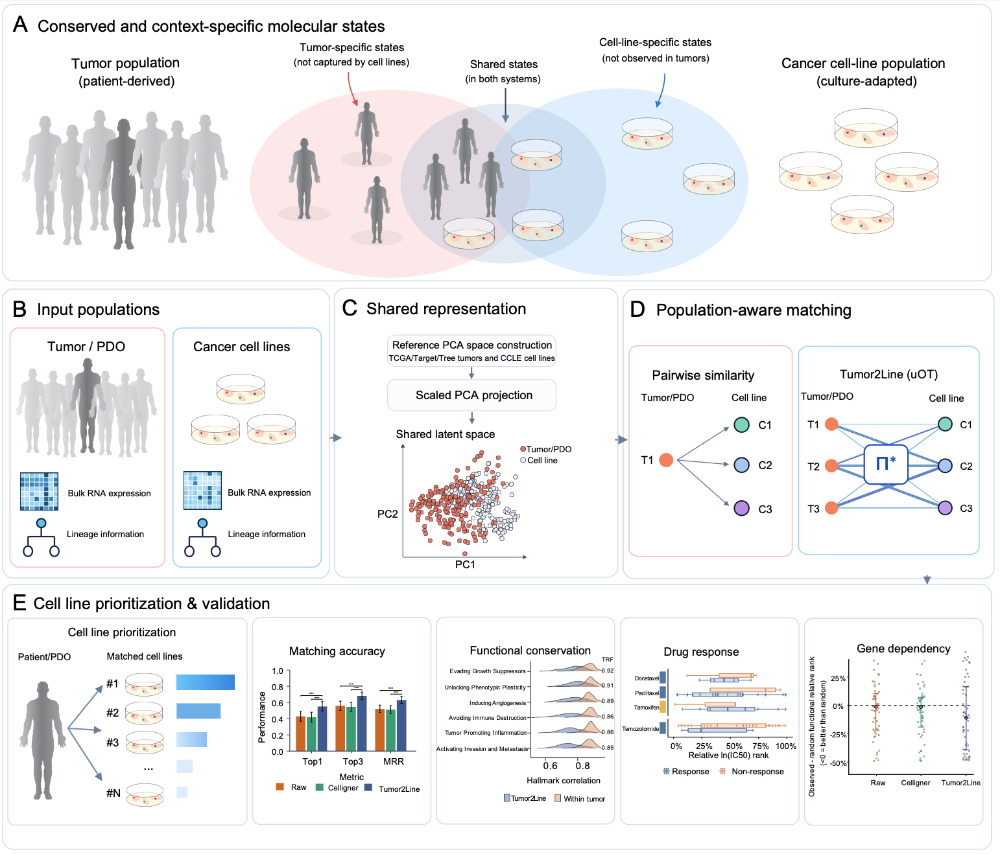

<!-- README.md is generated from this file. Please edit README.Rmd. -->

# Tumor2Line: Population-Aware Tumor–Cell Line Alignment

## Overview

**Tumor2Line** is a transcriptomic framework for population-aware
alignment of tumor-derived query samples with candidate cancer cell
lines. Query samples can include patient tumors, patient-derived
organoids (PDOs), patient-derived xenografts (PDXs), organoids, and
other tumor-derived models.

Tumor2Line combines a shared molecular representation with lineage-aware
**unbalanced optimal transport (uOT)** to account for the population
structure of both query samples and candidate cell lines. It produces a
ranked list of candidate cell lines for each query sample.

<div class="figure" style="text-align: center">


<p class="caption">

Overview of the Tumor2Line workflow
</p>

</div>

Known tumor–cell-line pairs are **not required** to run Tumor2Line. When
ground-truth pairs are available, matching performance can be evaluated
using **Top1 accuracy, Top3 accuracy, mean reciprocal rank (MRR), and
true-pair rank**.

## :sunny: Key Features

- Population-aware matching of tumor-derived query populations to
  candidate cancer cell-line populations.
- Supports tumors, PDOs, PDXs, organoids, and other tumor-derived
  models.
- Provides both **cohort-specific PCA** and projection into a frozen
  **external reference PCA** space.
- Allows users to build an external reference PCA once and reuse it for
  subsequent datasets.
- Supports lineage-aware and global candidate pools.
- Uses unbalanced optimal transport rather than relying only on
  independent pairwise similarity.
- Reports raw `transport_mass` and row-normalized `matching_probability`
  for each query–cell-line pair.
- Supports optional known-pair evaluation using Top1, Top3, MRR, and
  true-pair rank.
- Supports single-new-query prediction by adding the projected query to
  an existing query population and rerunning uOT (population mode).

## :arrow_double_down: Installation

Install the development version from GitHub:

``` r
# install.packages("devtools")
devtools::install_github(
  "Duan-Lab1/Tumor2Line",
  dependencies = c("Depends", "Imports", "LinkingTo")
)

library(Tumor2Line)
```

A source package can also be installed locally:

``` r
install.packages(
  "Tumor2Line_0.1.3.tar.gz",
  repos = NULL,
  type = "source"
)
```

## Expression input scales

Expression matrices must have samples in rows and genes in columns. The
first column (or the column specified by `sample_id_col`) contains
sample IDs.

Tumor2Line accepts two expression scales:

| `input_scale` | Meaning | Transformation |
|----|----|----|
| `"raw"` | Untransformed TPM | `log2(TPM + 1)` |
| `"processed"` | Already transformed `log2(TPM + 1)` | No additional transformation |

Here, `"raw"` means untransformed **TPM**, not raw RNA-seq read counts.
Raw counts must first be normalized to an appropriate expression unit,
such as TPM. Query and candidate cell-line matrices can specify their
input scales separately.

For the datasets used in the Tumor2Line examples:

- PDMR expression matrices use `input_scale = "raw"` because they
  contain TPM.
- Celligner expression matrices use `input_scale = "processed"` because
  they contain `log2(TPM + 1)` values.

## :rocket: Quick Start

### Read the bundled PDMR-format example

A small dataset is provided in `inst/extdata` so that users can run the
basic workflow without downloading the full study matrices.

``` r
query_expr_path <- system.file(
  "extdata", "demo_tumor_expr.tsv",
  package = "Tumor2Line"
)
cellline_expr_path <- system.file(
  "extdata", "demo_cellline_expr.tsv",
  package = "Tumor2Line"
)
phenotype_path <- system.file(
  "extdata", "demo_phenotype.tsv",
  package = "Tumor2Line"
)

query_expr <- utils::read.delim(
  query_expr_path,
  check.names = FALSE,
  stringsAsFactors = FALSE
)
cellline_expr <- utils::read.delim(
  cellline_expr_path,
  check.names = FALSE,
  stringsAsFactors = FALSE
)
phenotype <- utils::read.delim(
  phenotype_path,
  check.names = FALSE,
  stringsAsFactors = FALSE
)
```

The example phenotype table contains sample IDs, lineage annotations,
sample types, and known pair identifiers. Pair identifiers are used only
for downstream evaluation; they are not required for matching.

### Prepare the data

``` r
prepared <- prepare_tumor2line_data(
  query_expr = query_expr,
  cellline_expr = cellline_expr,
  phenotype = phenotype,
  sample_id_col = "SampleID",
  pair_col = "PairID",
  lineage_col = "lineage",
  sample_type_col = "SampleClass",
  query_type = "tumor",
  query_input_scale = "raw",
  cellline_input_scale = "raw"
)

prepared$cohort_summary
head(prepared$gold_pairs)
```

During preparation, Tumor2Line identifies samples represented in the
expression inputs and phenotype metadata, retains shared genes, and
converts the expression matrices to `log2(TPM + 1)` when required. Genes
are ranked by their standard deviation across the combined query and
cell-line expression matrix. The default workflow retains the top 10,000
variable genes; mean TPM and detected fraction are not applied as
additional default gene filters.

### Run cohort-specific Tumor2Line

``` r
result <- run_tumor2line(
  query_expr = query_expr,
  cellline_expr = cellline_expr,
  phenotype = phenotype,
  sample_id_col = "SampleID",
  pair_col = "PairID",
  lineage_col = "lineage",
  sample_type_col = "SampleClass",
  query_type = "tumor",
  query_input_scale = "raw",
  cellline_input_scale = "raw",
  n_variable_genes = 10000,
  pca_variance_threshold = 0.90,
  candidate_scope = "within_lineage",
  distance = "euclidean",
  epsilon = 0.1,
  rho_query = 1,
  rho_cellline = 1
)

result
```

The selected genes are jointly centered and scaled before PCA. The
number of retained principal components is determined by the cumulative
explained variance threshold (`pca_variance_threshold`), rather than by
a fixed number of PCs. The default matching uses Euclidean distance,
with the cost matrix normalized by its median positive value, followed
by entropically regularized uOT.

### Inspect candidate rankings

``` r
head(result$ranking)
result$top_matches

get_top_matches(result, n = 5)

example_query <- result$input$query_ids[1]
get_top_matches(
  result,
  n = 5,
  query_id = example_query
)
```

For each query, `rank = 1` is the highest-priority candidate cell line.
`transport_mass` is the raw coupling mass assigned to a query–cell-line
pair by the uOT transport plan. `matching_probability` is the transport
mass normalized across candidate cell lines for the same query and is
used for query-specific ranking; it is not a calibrated clinical
probability.

### Evaluate known pairs and visualize results

``` r
result$evaluation$summary
head(result$evaluation$pair_ranks)
result$evaluation$lineage

plot_tumor2line_accuracy(result)
plot_true_pair_ranks(result)
plot_top_matches(
  result,
  query_id = example_query,
  n = 5
)
```

Known pairs are optional. If no pairing information is available, set
`pair_col = NULL`; Tumor2Line will still perform matching, but
known-pair evaluation will not be available.

## :microscope: development-data generation

The full expression matrices are large and are distributed separately
from the lightweight package. The project data bundle, including the
full expression matrices, phenotype tables, and prebuilt reference PCA
object when available, can be downloaded from the [Tumor2Line RefData
Google Drive
folder](https://drive.google.com/drive/folders/1ez0FMwFGpUmFaUsHJO_RVPczy57s7vLb?usp=drive_link).

The expected data-bundle structure is:

``` text
Tumor2Line_RefData/
├── Celligner_tumor_gene_expression.tsv
├── Celligner_cellline_gene_expression.tsv
├── Celligner_phenotype.tsv
├── Celligner_reference_pca.rds
├── PDMR_tumor_gene_expression.tsv
├── PDMR_cellline_gene_expression.tsv
└── PDMR_phenotype.tsv
```

## :book: Vignettes

The package provides three tutorials:

1.  `Tumor2Line-tutorial`: standard PDMR population matching and
    known-pair evaluation using cohort-specific PCA.
2.  `Tumor2Line-reference-vs-cohort-pca`: comparison of cohort-specific
    PCA and external-reference PCA using the same query and candidate
    populations.
3.  `Tumor2Line-tumor-only`: matching tumor-only query samples to
    same-lineage CCLE cell lines by projection into the external
    Celligner reference PCA space.

Browse the installed vignettes:

``` r
utils::browseVignettes(package = "Tumor2Line")
```

## :sparkling_heart: Contributing

Contributions, suggestions, and bug reports are welcome through the
[Tumor2Line issue
tracker](https://github.com/Duan-Lab1/Tumor2Line/issues).

## :eight_pointed_black_star: Citation

``` r
citation("Tumor2Line")
```

## :writing_hand: Authors

- [Hua Zou](mailto:zouhua1@outlook.com)
- [Bin Duan](mailto:binduan@sjtu.edu.cn)
