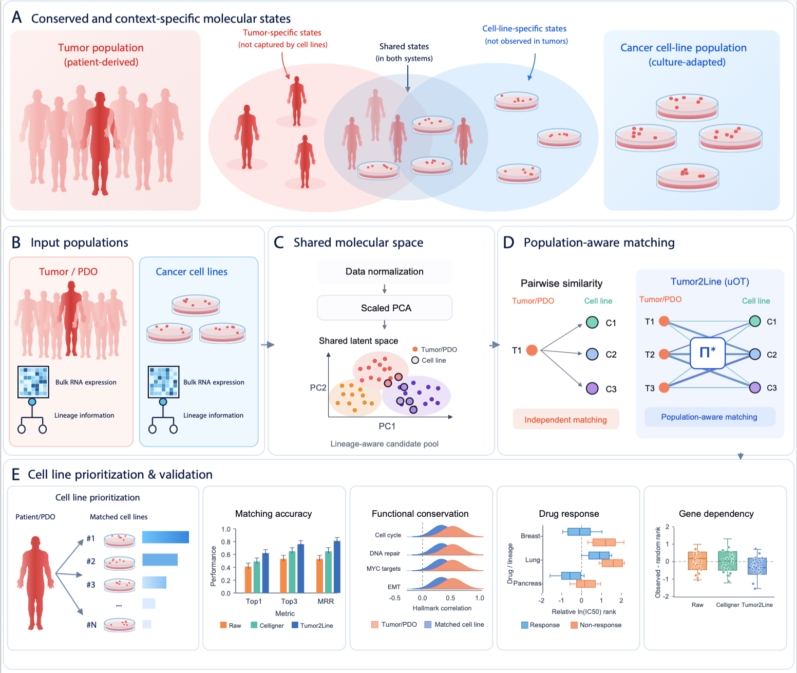

```{r setup, include=FALSE}
knitr::opts_chunk$set(
  collapse = TRUE,
  comment = "#>",
  fig.width = 5,
  fig.height = 4
)
```

## 1. Overview

**Tumor2Line** matches a query population to candidate cancer cell lines using transcriptomic similarity at the **population level**. Query samples may represent patient tumors, PDOs, PDXs, organoids, or other tumor-derived models.

```{r, echo=FALSE, out.width="80%", out.height="80%", dpi=600, fig.align="center", fig.cap="The Overview of Tumor2Line", fig.alt="Overview of the Tumor2Line workflow for population-aware matching between query samples and candidate cancer cell lines."}

```

The standard Tumor2Line workflow constructs a shared molecular representation using scaled PCA and performs population-aware matching with unbalanced optimal transport (uOT).

In many practical applications, a user may already have an established reference query cohort and later receive a single new query sample. Because Tumor2Line is designed as a population-level matching framework, the recommended strategy is to add the new query to the existing reference query cohort and rerun Tumor2Line on the combined query population.

This tutorial demonstrates that workflow using the bundled PDMR-format example dataset:

1. hold out one PDMR tumor and treat it as a newly arriving query;
2. use the remaining tumors as the reference query cohort;
3. add the held-out tumor back to the reference cohort;
4. rerun the complete Tumor2Line workflow on the combined query population;
5. extract the candidate cell-line ranking for the new query;
6. use the known PDMR pair only at the end to evaluate the prediction.

The held-out PDMR pairing information is not used during Tumor2Line matching.

## 2. Load Tumor2Line

```{r}
library(Tumor2Line)
```

## 3. Input data

### 3.1 Three logical input types

The bundled PDMR-format example uses:

```text
PDMR_tumor_expr.tsv
PDMR_cellline_expr.tsv
PDMR_phenotype.tsv
```

The two expression tables have samples in rows. `SampleID` identifies each sample and the remaining columns contain non-negative gene-expression values. In this example, the phenotype table contains:

- `SampleID`: sample identifier;
- `PairID`: known query-cell line pair identifier used only for evaluation;
- `SampleClass`: biological sample type (`tumor` or `cellline` in this example);
- `lineage`: cancer lineage used to define the default candidate pool.

Tumor2Line does not require `PairID` or `SampleClass` for matching. The roles `query` and `cellline` are inferred from the two expression inputs.

### 3.2 Read the bundled example

```{r}
query_expr_path <- system.file("extdata", "PDMR_tumor_expr.tsv", package = "Tumor2Line")
cell_expr_path <- system.file("extdata", "PDMR_cellline_expr.tsv", package = "Tumor2Line")
phenotype_path <- system.file("extdata", "PDMR_phenotype.tsv", package = "Tumor2Line")
```

```{r}
query_expr <- utils::read.delim(query_expr_path, check.names = FALSE, stringsAsFactors = FALSE)
cellline_expr <- utils::read.delim(cell_expr_path, check.names = FALSE, stringsAsFactors = FALSE)
phenotype <- utils::read.delim(phenotype_path, check.names = FALSE, stringsAsFactors = FALSE)
```

Inspect the three inputs:

```{r}
dim(query_expr)
dim(cellline_expr)
dim(phenotype)

query_expr[1:3, 1:6]
cellline_expr[1:3, 1:6]
utils::head(phenotype)
```

The first column of each expression table is `SampleID`.

## 4. Create a held-out new query

The PDMR dataset contains multiple query samples. To mimic a realistic single-query application, one tumor is held out and treated as a newly arriving query.

The held-out query is initially removed from the reference query cohort. Its known `PairID` is retained separately and is used only for final evaluation.

### 4.1 Identify eligible query samples

The held-out sample is selected from a lineage containing at least two query samples so that at least one query from the same lineage remains in the reference cohort. We additionally require the held-out sample to have a known PDMR pair so that its final ranking can be evaluated.

```{r}
query_ids <- as.character(query_expr$SampleID)
cellline_ids <- as.character(cellline_expr$SampleID)

query_meta <- phenotype[phenotype$SampleID %in% query_ids, , drop = FALSE]
cellline_meta <- phenotype[phenotype$SampleID %in% cellline_ids, , drop = FALSE]

query_lineage_count <- table(query_meta$lineage)

eligible_lineages <- names(query_lineage_count[query_lineage_count >= 2])

eligible_lineages <- intersect(
  eligible_lineages,
  unique(cellline_meta$lineage)
)

valid_cellline_pair_ids <- unique(
  cellline_meta$PairID[!is.na(cellline_meta$PairID) & cellline_meta$PairID != ""]
)

eligible_query_meta <- query_meta[
  query_meta$lineage %in% eligible_lineages &
    !is.na(query_meta$PairID) &
    query_meta$PairID != "" &
    query_meta$PairID %in% valid_cellline_pair_ids, ,
  drop = FALSE
]

if (nrow(eligible_query_meta) == 0) {
  stop(
    "No eligible PDMR query is available for the single-query tutorial.",
    call. = FALSE
  )
}
```

### 4.2 Randomly hold out one query

A fixed random seed makes the vignette reproducible.

```{r}
set.seed(123)

new_query_id <- sample(eligible_query_meta$SampleID, 1)
new_query_meta_full <- phenotype[phenotype$SampleID == new_query_id, , drop = FALSE]
new_query_lineage <- as.character(new_query_meta_full$lineage[1])

new_query_id
new_query_lineage
```

Separate the held-out query expression from the reference query cohort:

```{r}
new_query_expr <- query_expr[query_expr$SampleID == new_query_id, , drop = FALSE]
reference_query_expr <- query_expr[query_expr$SampleID != new_query_id, , drop = FALSE]

dim(new_query_expr)
dim(reference_query_expr)
```

All candidate cell lines remain available. This includes the true paired cell line of the held-out PDMR query because the practical prediction task is to determine where that candidate appears in the final ranking.

### 4.3 Separate ground truth from model inputs

The known `PairID` of the held-out PDMR query is retained only for evaluation.

```{r}
heldout_pair_id <- as.character(new_query_meta_full$PairID[1])
true_cellline_ids <- cellline_meta$SampleID[cellline_meta$PairID == heldout_pair_id]

heldout_truth <- data.frame(
  Query_ID = new_query_id,
  PairID = heldout_pair_id,
  lineage = new_query_lineage,
  True_CellLine_ID = true_cellline_ids,
  stringsAsFactors = FALSE
)

heldout_truth
```

Construct metadata for Tumor2Line without pairing information:

```{r}
reference_sample_ids <- c(
  reference_query_expr$SampleID,
  cellline_expr$SampleID
)

reference_phenotype <- phenotype[
  phenotype$SampleID %in% reference_sample_ids, ,
  drop = FALSE
]

reference_phenotype_model <- reference_phenotype[
  ,
  setdiff(names(reference_phenotype), "PairID"),
  drop = FALSE
]

new_query_metadata <- new_query_meta_full[
  ,
  setdiff(names(new_query_meta_full), "PairID"),
  drop = FALSE
]
```

The held-out PDMR pair is therefore unavailable to Tumor2Line during matching.

## 5. Build the reference Tumor2Line cohort

The remaining PDMR tumors form the reference query cohort. Before adding the new tumor, we can run Tumor2Line on this existing cohort to establish the reference population.

```{r}
reference_result <- run_tumor2line(
  query_expr = reference_query_expr,
  cellline_expr = cellline_expr,
  phenotype = reference_phenotype_model,
  sample_id_col = "SampleID",
  pair_col = NULL,
  lineage_col = "lineage",
  sample_type_col = "SampleClass",
  query_type = "tumor",
  n_variable_genes = 10000,
  pca_variance_threshold = 0.90,
  max_pcs = NULL,
  candidate_scope = "within_lineage",
  distance = "euclidean",
  epsilon = 0.1,
  rho_query = 1,
  rho_cellline = 1,
  evaluate = FALSE
)

reference_result
```

### 5.1 Reference molecular representation

Tumor2Line constructs the reference molecular representation using:

```text
reference queries + candidate cell lines
        ->
log2(TPM + 1)
        ->
gene filtering and variable-gene selection
        ->
joint gene-wise scaling
        ->
PCA
        ->
PCs reaching 90% cumulative variance
        ->
PC-wise scaling
```

```{r}
reference_result$representation$n_pcs
utils::head(reference_result$representation$variance)
```

### 5.2 Reference population-aware matching

The reference query cohort is matched jointly to the candidate cell-line population using uOT.

```{r}
utils::head(reference_result$ranking)
```

Important columns include:

- `Query_ID`: reference query sample;
- `CellLine_ID`: candidate cell line;
- `transport_mass`: raw pair-specific mass assigned by the uOT transport plan;
- `matching_probability`: query-normalized transport mass used to express relative candidate priority;
- `query_total_mass`: total transport mass assigned from that query to all candidate cell lines;
- `cellline_total_mass`: total transport mass received by that candidate cell line from the query population;
- `cost`: molecular distance used by uOT;
- `rank`: query-specific candidate rank;
- `n_candidates`: size of the candidate pool.

## 6. Add the new query to the reference population

For a newly arriving single query, Tumor2Line does not match that sample in isolation. Instead, the new query is added to the existing reference query cohort, forming an updated query population.

The complete Tumor2Line workflow is then rerun on the combined query population and candidate cell-line population.

```text
reference query cohort
        +
new query
        ↓
combined query population
        +
candidate cell lines
        ↓
scaled PCA
        ↓
population-aware uOT
        ↓
new-query cell-line ranking
```

### 6.1 Combine the new query with the reference cohort

```{r}
combined_query_expr <- rbind(
  reference_query_expr,
  new_query_expr
)

combined_query_ids <- as.character(combined_query_expr$SampleID)

combined_phenotype_model <- phenotype[
  phenotype$SampleID %in% c(combined_query_ids, cellline_ids), ,
  drop = FALSE
]

combined_phenotype_model <- combined_phenotype_model[
  ,
  setdiff(names(combined_phenotype_model), "PairID"),
  drop = FALSE
]

dim(combined_query_expr)
dim(combined_phenotype_model)
```

The new query is now part of the query population. Its expression profile therefore contributes to the molecular representation and to the subsequent population-aware uOT matching.

### 6.2 Rerun Tumor2Line on the combined population

```{r}
population_result <- run_tumor2line(
  query_expr = combined_query_expr,
  cellline_expr = cellline_expr,
  phenotype = combined_phenotype_model,
  sample_id_col = "SampleID",
  pair_col = NULL,
  lineage_col = "lineage",
  sample_type_col = "SampleClass",
  query_type = "tumor",
  n_variable_genes = 10000,
  pca_variance_threshold = 0.90,
  max_pcs = NULL,
  candidate_scope = "within_lineage",
  distance = "euclidean",
  epsilon = 0.1,
  rho_query = 1,
  rho_cellline = 1,
  evaluate = FALSE
)

population_result
```

This step reruns the complete Tumor2Line workflow after the new query has been incorporated into the population.

### 6.3 Extract the new-query ranking

```{r}
new_query_top5 <- get_top_matches(
  population_result,
  n = 5,
  query_id = new_query_id
)

new_query_top5
```

To inspect the full candidate ranking for the new query:

```{r}
new_query_ranking <- population_result$ranking[
  population_result$ranking$Query_ID == new_query_id, ,
  drop = FALSE
]

new_query_ranking[,
  c("Query_ID",
    "CellLine_ID",
    "transport_mass",
    "matching_probability",
    "query_total_mass",
    "cellline_total_mass",
    "cost",
    "rank")] |>
  utils::head(10)
```

Here:

- `transport_mass` is the raw uOT mass assigned to the new query-cell-line pair;
- `matching_probability` is the query-normalized transport mass;
- `query_total_mass` is the total mass transported from the new query;
- `rank = 1` is the highest-priority candidate cell line.

## 7. Evaluate the held-out PDMR pair

Because the selected PDMR query has known pairing information, we can now reveal the held-out ground truth and locate the known paired cell line in the new query's ranking.

```{r}
true_rows <- new_query_ranking[
  new_query_ranking$CellLine_ID %in% true_cellline_ids, ,
  drop = FALSE]

if (nrow(true_rows) == 0) {
  single_query_evaluation <- data.frame(
    Query_ID = new_query_id,
    Top_candidate = new_query_top5$CellLine_ID[1],
    True_CellLine_ID = NA_character_,
    True_pair_rank = NA_integer_,
    Top1 = FALSE,
    Top3 = FALSE,
    Reciprocal_rank = NA_real_,
    stringsAsFactors = FALSE
  )
} else {
  true_row <- true_rows[which.min(true_rows$rank), , drop = FALSE]

  single_query_evaluation <- data.frame(
    Query_ID = new_query_id,
    Top_candidate = new_query_top5$CellLine_ID[1],
    True_CellLine_ID = true_row$CellLine_ID[1],
    True_pair_rank = as.integer(true_row$rank[1]),
    Top1 = true_row$rank[1] <= 1,
    Top3 = true_row$rank[1] <= 3,
    Reciprocal_rank = 1 / true_row$rank[1],
    stringsAsFactors = FALSE
  )
}

single_query_evaluation
```

For a single held-out query, the most useful quantities are:

- `True_pair_rank`: rank of the known paired cell line;
- `Top1`: whether the true pair was ranked first;
- `Top3`: whether the true pair was ranked within the first three candidates;
- `Reciprocal_rank`: `1 / true_pair_rank`.

These are sample-level outcomes rather than cohort-level accuracy estimates.

The single held-out example is intended to demonstrate package usage. A formal performance assessment would require repeating the held-out procedure across many or all PDMR queries.

## 8. Why population context matters

Tumor2Line is designed to match query and cell-line populations jointly rather than scoring each query-cell-line pair independently.

When a new tumor is analyzed, it is therefore added to the existing reference query cohort before Tumor2Line is rerun.

```text
single new query
        +
reference query cohort
        ↓
updated query population
        ↓
joint molecular representation
        ↓
population-aware uOT
        ↓
candidate cell-line ranking
```

This preserves the central population-level design of Tumor2Line. The candidate ranking for the new query is obtained in the context of the other query samples and the candidate cell-line population.

## 9. When should I use this workflow?

Use this single-query workflow when:

- one new tumor, PDO, PDX, organoid, or other query sample needs candidate cell-line selection;
- an existing reference query cohort is available;
- the new query can be combined with that reference cohort using compatible expression measurements;
- population-aware Tumor2Line matching is desired.

The recommended procedure is:

```text
new query
        +
reference query cohort
        ↓
rerun Tumor2Line
        ↓
extract new-query candidate ranking
```

If no reference query cohort is available, the new sample lacks query-side population context. In that setting, a pairwise query-cell-line similarity analysis may still be possible, but it is not the full population-aware Tumor2Line workflow.

## 10. Standard cohort analysis

The same `run_tumor2line()` function is used when multiple query samples are analyzed simultaneously.

```{r}
cohort_result <- run_tumor2line(
  query_expr = query_expr,
  cellline_expr = cellline_expr,
  phenotype = phenotype,
  sample_id_col = "SampleID",
  pair_col = "PairID",
  lineage_col = "lineage",
  sample_type_col = "SampleClass",
  query_type = "tumor",
  n_variable_genes = 10000,
  pca_variance_threshold = 0.90,
  max_pcs = NULL,
  candidate_scope = "within_lineage",
  distance = "euclidean",
  epsilon = 0.1,
  rho_query = 1,
  rho_cellline = 1
)

cohort_result
```

### 10.1 Candidate rankings

```{r}
utils::head(cohort_result$ranking)
```

The principal ranking columns are:

- `Query_ID`: focal query sample;
- `CellLine_ID`: candidate cell line;
- `transport_mass`: raw pair-specific mass assigned by the uOT transport plan;
- `matching_probability`: query-normalized transport mass, calculated as the pair-specific `transport_mass` divided by the total transport mass assigned from that query to all candidate cell lines;
- `query_total_mass`: total mass transported from the focal query;
- `cellline_total_mass`: total mass received by the candidate cell line;
- `cost`: molecular distance used by uOT;
- `rank`: query-specific candidate rank based on `matching_probability`;
- `n_candidates`: size of the candidate pool.

### 10.2 Top candidates

```{r}
cohort_top5 <- get_top_matches(
  cohort_result,
  n = 5
)

utils::head(cohort_top5, 10)
```

### 10.3 Known-pair evaluation

Because the PDMR example contains known pairs, cohort-level performance can be summarized automatically:

```{r}
cohort_result$evaluation$summary
```

The principal cohort metrics are:

- **Top1 accuracy**;
- **Top3 accuracy**;
- **mean reciprocal rank (MRR)**;
- **true-pair rank**.

These metrics are available only when known pairing information is supplied.

## 11. Visualization

### 11.1 Cohort-level Top1, Top3 and MRR

```{r fig-accuracy, fig.alt="Bar chart showing Top1 accuracy, Top3 accuracy, and mean reciprocal rank for Tumor2Line matching."}
plot_tumor2line_accuracy(cohort_result)
```

### 11.2 True-pair rank distribution

```{r fig-rank, fig.alt="Distribution of the ranks of known paired cell lines across query samples. Lower ranks indicate better matching."}
plot_true_pair_ranks(cohort_result)
```

Lower true-pair ranks indicate better recovery. Rank 1 means Tumor2Line selected the known paired cell line as its first recommendation.

### 11.3 Candidate cell lines for the held-out query

```{r fig-population-top, fig.alt="Top five candidate cell lines for the held-out query after it is added to the reference query cohort and Tumor2Line is rerun."}
plot_top_matches(
  population_result,
  query_id = new_query_id,
  n = 5
)
```

## 12. Using your own data

### 12.1 Standard query cohort

For a new dataset containing multiple query samples:

```r
query_expr <- read.delim(
  "query_gene_expression.tsv",
  check.names = FALSE
)

cellline_expr <- read.delim(
  "cellline_gene_expression.tsv",
  check.names = FALSE
)

phenotype <- read.delim(
  "phenotype.tsv",
  check.names = FALSE
)

result <- run_tumor2line(
  query_expr = query_expr,
  cellline_expr = cellline_expr,
  phenotype = phenotype,
  sample_id_col = "SampleID",
  pair_col = NULL,
  lineage_col = "lineage",
  candidate_scope = "within_lineage"
)

get_top_matches(
  result,
  n = 5
)
```

The query population may contain tumors, PDOs, PDXs, organoids, or other tumor-derived samples.

### 12.2 Add one new query to an existing reference cohort

Assume `reference_query_expr` contains the existing reference query population and `new_query_expr` contains one newly arriving query.

```r
combined_query_expr <- rbind(
  reference_query_expr,
  new_query_expr
)
```

The metadata for the new query should be added to the metadata for the existing reference cohort and candidate cell lines:

```r
combined_phenotype <- rbind(
  reference_query_metadata,
  new_query_metadata,
  cellline_metadata
)
```

Then rerun Tumor2Line on the combined query population:

```r
result <- run_tumor2line(
  query_expr = combined_query_expr,
  cellline_expr = cellline_expr,
  phenotype = combined_phenotype,
  sample_id_col = "SampleID",
  pair_col = NULL,
  lineage_col = "lineage",
  candidate_scope = "within_lineage"
)
```

Finally, extract the candidate cell lines for the new query:

```r
get_top_matches(
  result,
  n = 5,
  query_id = new_query_id
)
```

This is the recommended Tumor2Line workflow for a single newly arriving query when a reference query cohort is available.

## 13. Summary

Tumor2Line is fundamentally a population-aware matching framework.

For a standard query cohort:

```text
query population
        +
candidate cell-line population
        ↓
scaled PCA
        ↓
population-aware uOT
        ↓
query-specific cell-line rankings
```

For one newly arriving query:

```text
reference query cohort
        +
new query
        ↓
updated query population
        +
candidate cell-line population
        ↓
rerun Tumor2Line
        ↓
new-query candidate cell-line ranking
```

The new query is therefore analyzed as part of a query population rather than as an isolated sample.

Known query-cell-line pairing information is never required for matching and is used only when ground-truth evaluation is available.

## 14. Session information

```{r}
sessionInfo()
```
