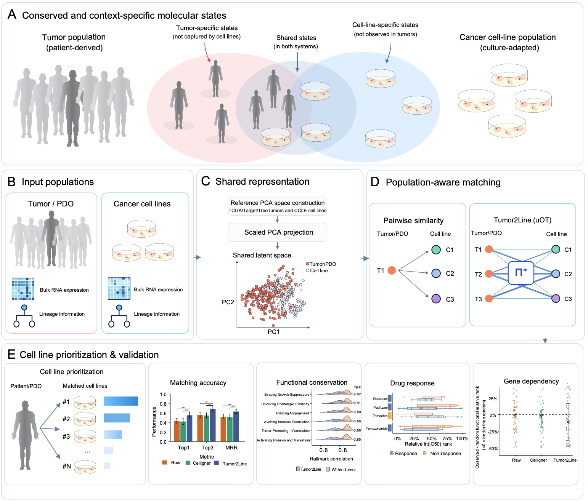

```{r setup, include=FALSE}
knitr::opts_chunk$set(
  collapse = TRUE,
  comment = "#>",
  fig.width = 6.5,
  fig.height = 4.5
)
```

## Introduction

**Tumor2Line** reframes cancer cell-line selection as a **population-aware alignment problem** rather than a conventional pairwise nearest-neighbor search. Because tumors and cell lines represent heterogeneous, incompletely overlapping biological landscapes, independent pairwise ranking fails to capture the broader population context.

The package provides a two-component workflow:

1. **Shared Representation**: Tumor and lineage-compatible cell-line transcriptomes are projected into a common low-dimensional PCA space. The PCA is built from large-scale reference datasets (TCGA, TARGET, Treehouse, CCLE), enabling stable, reusable projection for new samples—especially useful when only a few patient tumors are available. PC scores are standardized to unit variance to balance the contributions of high-variance microenvironmental signals and subtle biological differences.

2. **Population-Aware Matching via uOT**: Unbalanced optimal transport (uOT) aligns tumor and cell-line populations in the shared space. Unlike independent pairwise similarity, uOT leverages distributional relationships between populations and relaxes strict mass-conservation constraints to accommodate incomplete overlap. The resulting transport plan yields ranked candidate cell lines per tumor.

**Validation**: A multi-level framework evaluates Tumor2Line via recovery of experimentally matched pairs, molecular-state fidelity, and independent functional validation using drug responses and CRISPR gene dependencies.

```{r, echo=FALSE, out.width="80%", out.height="80%", dpi=600, fig.align="center", fig.cap="The Overview of Tumor2Line"}

```

This tutorial demonstrates the standard cohort-specific workflow using the 103 one-to-one demo tumor–cell-line pairs. The demo expression matrices are TPM and are transformed to `log2(TPM + 1)` exactly once. Known `PairID` values are used only for evaluation after matching; they are not used to construct the PCA representation or the uOT transport plan.

The full demo expression matrices are large and are not bundled in this source archive. The code chunks in this tutorial run when the complete files have been copied to `inst/extdata/` by `data-raw/debug.R`. Until then, the executable chunks are skipped during vignette building.

## Load Tumor2Line

```{r}
library(Tumor2Line)
library(ggplot2)
library(dplyr)
library(tidyr)
```

## Input data

### Three logical input types

The demo data workflow uses:

```text
demo_tumor_expr.tsv
demo_cellline_expr.tsv
demo_phenotype.tsv
```

Both expression tables contain samples in rows and genes in columns. The phenotype table contains:

- `SampleID`: sample identifier;
- `PairID`: known tumor–cell-line pair identifier, used only for evaluation;
- `SampleClass`: `tumor` or `cellline`;
- `model_lineage`: harmonized lineage used for within-lineage candidate matching.

### Read the bundled demo data

```{r}
query_expr_path <- system.file(
  "extdata", "demo_tumor_expr.tsv", package = "Tumor2Line"
)

cellline_expr_path <- system.file(
  "extdata", "demo_cellline_expr.tsv", package = "Tumor2Line"
)

phenotype_path <- system.file(
  "extdata", "demo_phenotype.tsv", package = "Tumor2Line"
)

query_expr <- data.table::fread(query_expr_path)
cellline_expr <- data.table::fread(cellline_expr_path)
phenotype <- data.table::fread(phenotype_path)
```

Inspect the input dimensions and annotations:

```{r}
dim(query_expr)
dim(cellline_expr)
dim(phenotype)
query_expr[1:3, 1:6]
cellline_expr[1:3, 1:6]
utils::head(phenotype)
table(phenotype$model_lineage, phenotype$SampleClass)
```

## Data preparation

`prepare_tumor2line_data()` harmonizes common genes, converts raw TPM to `log2(TPM + 1)`, checks sample metadata and constructs known pairs when `PairID` is supplied. Genes are ranked by their standard deviation across the combined log-expression matrix; the default workflow retains the top 10,000 variable genes. Mean TPM and detected fraction are not used as default filtering criteria.

```{r}
prepared <- prepare_tumor2line_data(
  query_expr = query_expr,
  cellline_expr = cellline_expr,
  phenotype = phenotype,
  sample_id_col = "SampleID",
  pair_col = "PairID",
  lineage_col = "model_lineage",
  sample_type_col = "SampleClass",
  query_type = "tumor",
  cellline_type = "cellline",
  query_input_scale = "raw",
  cellline_input_scale = "raw"
)

prepared$cohort_summary
head(prepared$gold_pairs)
```

## Scaled-PCA molecular representation

The standard demo representation follows this sequence:

```text
Raw TPM
  -> log2(TPM + 1)
  -> calculate gene-wise SD on log2(TPM + 1)
  -> select the 10,000 genes with the largest SD
  -> joint gene-wise centering and scaling
  -> PCA
  -> retain the smallest number of PCs reaching 90% cumulative variance
  -> PC-wise scaling
```

The PC count is determined by the variance threshold.

```{r}
representation <- build_scaled_pca_representation(
  input = prepared,
  n_variable_genes = 10000,
  pca_variance_threshold = 0.90,
  scale_genes = TRUE
)

representation$n_pcs
utils::tail(representation$variance, 10)
```

## Run Tumor2Line

`run_tumor2line()` is the main entry point for cohort-specific analysis. It runs data preparation, scaled PCA, lineage-aware uOT matching, candidate ranking and optional known-pair evaluation.

```{r}
result <- run_tumor2line(
  query_expr = query_expr,
  cellline_expr = cellline_expr,
  phenotype = phenotype,
  sample_id_col = "SampleID",
  pair_col = "PairID",
  lineage_col = "model_lineage",
  sample_type_col = "SampleClass",
  query_type = "tumor",
  cellline_type = "cellline",
  query_input_scale = "raw",
  cellline_input_scale = "raw",
  n_variable_genes = 10000,
  pca_variance_threshold = 0.90,
  candidate_scope = "within_lineage",
  distance = "euclidean",
  epsilon = 0.1,
  rho_query = 1,
  rho_cellline = 1,
  max_iter = 5000,
  tolerance = 1e-8
)

result
```

The default Euclidean cost is the mean squared L2 distance divided by the number of retained PCs. The cost matrix is normalized by its median positive value before uOT.

## Understand the result object

```{r}
names(result)
head(result$ranking)
result$top_matches
```

Important ranking columns are:

- `Query_ID`: focal tumor;
- `CellLine_ID`: candidate cell line;
- `transport_mass`: raw uOT coupling mass assigned to this tumor–cell-line pair;
- `matching_probability`: transport mass normalized across all candidates for the same tumor;
- `cost`: normalized molecular distance;
- `rank`: tumor-specific candidate rank;
- `n_candidates`: number of candidate cell lines in the matching pool.

`transport_mass` is the raw mass in the transport plan. `matching_probability` is a row-normalized relative weight used for ranking; it is not a calibrated clinical probability.

```{r}
top5 <- get_top_matches(result, n = 5)
utils::head(top5, 10)

example_query <- result$input$query_ids[1]
get_top_matches(result, n = 5, query_id = example_query)
```

## Evaluate known demo pairs

The true demo pairs are not used during matching. They are used after ranking to calculate recovery metrics.

```{r}
evaluation <- result$evaluation
evaluation$summary
evaluation$lineage
head(evaluation$pair_ranks)
```

The principal metrics are:

- **Top1 accuracy**: fraction of tumors whose known paired cell line ranks first;
- **Top3 accuracy**: fraction whose known paired cell line appears within the top three;
- **MRR**: mean reciprocal rank of the known paired cell line;
- **True-pair rank**: rank of the known paired cell line for each tumor.

## Visualization

### Top1, Top3 and MRR

```{r fig-accuracy, fig.alt="Bar plot showing Top1 accuracy, Top3 accuracy and mean reciprocal rank for demo known tumor-cell-line pairs."}
plot_tumor2line_accuracy(result)
```

### True-pair rank distribution

```{r fig-rank, fig.alt="Histogram showing the ranking positions of known demo paired cell lines."}
plot_true_pair_ranks(result)
```

### Candidate cell lines for one tumor

```{r fig-top-matches, fig.alt="Bar plot showing the top-ranked candidate cell lines and their row-normalized transport masses for one demo tumor."}
plot_top_matches(result, query_id = example_query, n = 5)
```

## Using unpaired data

For a new dataset without known pairs, set `pair_col = NULL`. Pairing information is not required for matching; only the optional ground-truth evaluation is unavailable.

```r
unpaired_result <- run_tumor2line(
  query_expr = query_expr,
  cellline_expr = cellline_expr,
  phenotype = phenotype,
  sample_id_col = "SampleID",
  pair_col = NULL,
  lineage_col = "model_lineage",
  query_input_scale = "raw",
  cellline_input_scale = "raw"
)
```

## Session information

```{r}
sessionInfo()
```
